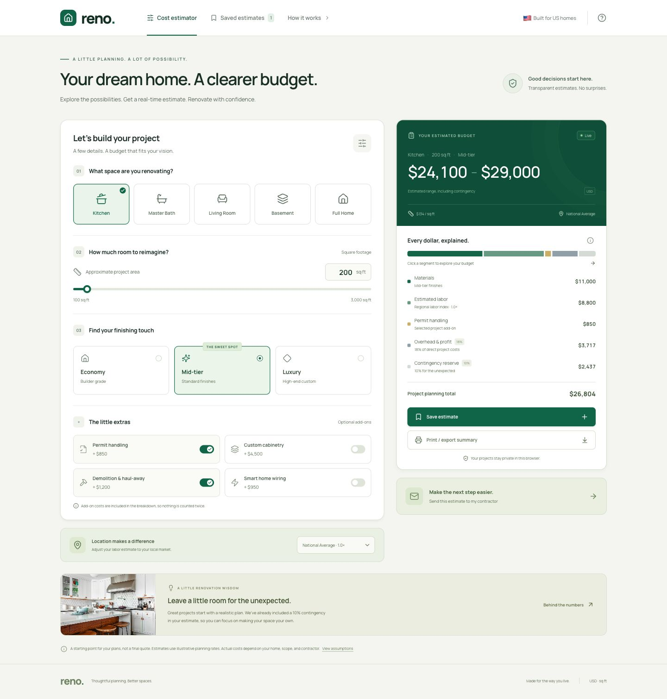

# Reno — Home Renovation Cost Estimator

A clear starting point for a kitchen, bathroom, basement, living room, or whole-home remodel. Build an estimate around your square footage, finish level, local labor index, and project add-ons; then save it, print it, or prepare it for a contractor.



## Features

- Live USD estimates for five project types and 100–3,000 sq ft.
- Economy, mid-tier, and luxury finish levels, plus four US labor indices and four optional add-ons.
- Itemized materials, labor, permits, 18% contractor overhead and profit, and a 10% contingency.
- Interactive cost distribution, estimate history, and a US Letter print layout.
- Validated contact form that prepares an itemized email draft for the homeowner to review and send. It does not send email or upload contact details.
- Responsive layout and keyboard accessible controls.

## Run locally

Requires Node.js 22 or later and pnpm 11.25.0.

```sh
pnpm install
pnpm dev
```

Automated pricing checks and production build:

```sh
pnpm test
pnpm build
pnpm preview
```

## Estimate assumptions

The room rates, finish multipliers, regional labor indices, and add-on allowances are editable in [`src/estimate.ts`](src/estimate.ts). They are illustrative planning estimates, not live market data or contractor quotes. The regional index adjusts base labor only. Overhead is 18% of direct costs; contingency is 10% of direct costs plus overhead. The displayed range is 90–108% of the estimate, rounded outward to $100.

Local project settings are saved in the browser. No account or external lead service is required.

## Stack

React, TypeScript, Tailwind CSS, Lucide React, and Vite.

